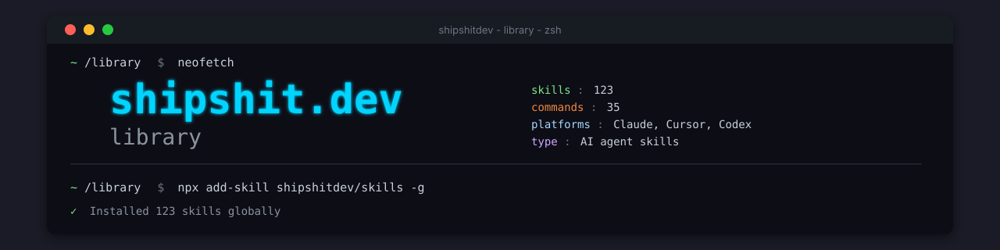

# Ship Shit Dev Skills


14 user-invoked commands for development workflows. Works with Claude Code,
OpenAI Codex, and Cursor.

Every command is one word. Related workflows share a command and take an action
as their first word (`/git pr`, `/issue prd`, `/check grok`); the action's
playbook lives in that skill's `references/`.

Every skill sets `disable-model-invocation: true`. The model never picks one up on
its own; you run it by name (`/git cleanup`, `/qa`, `/browse`). Skills that
compose others read the other playbook directly, so they still work without
exposing those skills to the model.

Skills are model-agnostic playbooks: the harness supplies the model and effort, and
no skill names a concrete model. Standards live in
[`.agents/memory/system/skill-standards.md`](.agents/memory/system/skill-standards.md).

## Quick start

1. Install the skills (and, optionally, the [companion libraries](#companion-libraries)):

   ```bash
   bunx skills add shipshitdev/skills -g --agent claude-code codex cursor --skill '*' -y
   ```

2. Run the core loop on a real task:

   ```text
   /issue add CSV export to the invoices page
   /execute #123
   /check
   /git pr
   /git merge
   ```

Every command takes free text after its name. `/issue`, `/qa`, and `/check` run
their main action when the first word is not an action; `/git`, `/board`, and
`/orchestrate help` print their actions instead of guessing.

## How to use

### Ship a feature

```text
/issue <rough request>             # requirements, plan, readiness check, one issue
/execute #<issue>                  # implement exactly the plan, collect evidence
/test                              # changed scope; `full`, `e2e`, `types`, `<path>` widen it
/check                             # Standards + Spec review of the branch or PR
/git pr                            # push and open or update the PR
/git ci                            # when checks go red; loops until green on request
```

Need only one piece? `/issue prd` interviews you and drafts requirements,
`/issue plan` turns settled requirements into steps, and `/issue check` tells you
whether an issue is ready to execute. `/issue publish` files a finished PRD as an
issue with sub-issues.

### Fix a bug

```text
/issue bug draft checkout total ignores the discount code   # preview only
/issue bug checkout total ignores the discount code         # preview, then file
/execute #<bug>
```

To root-cause before filing, run an upstream debugging skill such as
`diagnosing-bugs` or `/pstack:why`.

### QA the running app

```text
/qa                                # branch qa/YYYY-MM-DD off fresh origin trunk, then fix what you report
/qa the onboarding flow            # same loop, focused on one area
/qa review                         # check finished agent work against the ask
/browse open the dashboard and screenshot the empty state
```

`/qa` stays in the current checkout and starts a new QA branch from freshly
fetched `origin/<default>`; with uncommitted changes it stops and lists them
instead. It makes one local commit per fix and never pushes, opens a PR, or
deploys. Publish the branch afterwards with `/git pr`.

### Review

```text
/check                             # current branch against its base
/check #42                         # a PR
/check adversarial #42             # multi-model panel, with pstack interrogate installed
/check grok #42                    # second opinion from the Grok CLI, findings verified
/check council #42                 # panel of every installed provider CLI, scored rounds in the PR body
```

### Land and clean up

```text
/git babysit #42                   # watch a PR through CI and review, fix real findings
/git modernize #42                 # judge a stale PR, then update it by merging its base
/git merge                         # review, confirm, merge green PRs, list cleanup candidates
/git merge review                  # review only, merge nothing
/git merge force                   # drain the queue: merge green PRs, fix red ones, move on
/git cleanup                       # dry-run: proves what is merged, deletes nothing
/git cleanup prune                 # remove the proven-merged branches and worktrees from that plan
/git worktree fix-auth from develop
/git conflicts                     # resolve the current merge or rebase
/git safety                        # staged-secret check before a commit
```

### Release and deploy

```text
/release                           # status of trunk, gates, and the next version
/release cut minor
/deploy staging
```

### Daily standup

```text
/standup                           # your commits, last 24 hours
/standup 7d                        # your commits, last 7 days
/standup all 24                    # everyone's changes merged into trunk, last 24 hours
/standup all 24 audit              # same, plus individual and combined review
```

`/standup` is report-only. It traces every bullet to a diff and keeps merged
separate from deployed.

### Weekly review and retros

```text
/check week                        # last 7 days, report only
/check week since <SHA> --fix      # also repair confirmed findings in scope, via PRs
```

For a retrospective on how the work went (not what shipped), use the upstream
`/retro` (mattpocock) or `/pstack:reflect`.

### Run several sessions at once

```text
/orchestrate status                # what every project session is doing
/orchestrate plan bugs first       # propose lanes, dispatch nothing
/orchestrate run finish the bugs   # coordinate existing sessions, routing their questions
/orchestrate help
```

### Boards

```text
/board configure <board URL>       # audit fields, views, and workflows on a GitHub or Jira board
/board sync <board URL>            # reconcile cards with real PR and deploy state
```

## Commands

| Command | Actions | What it does |
|---|---|---|
| `/issue` | `feature` (default), `prd`, `plan`, `check`, `publish`, `bug` | Prepares work as GitHub issues: requirements, plan, readiness gate, publishing, bug reports. |
| `/execute` | | Executes a prepared issue and tracks review, CI, merge, and deploy evidence. |
| `/test` | | Runs tests at the right scope and reports failures with evidence. |
| `/qa` | `run` (default), `review` | Interactive localhost QA loop, or a verification pass over finished agent work. |
| `/check` | `code` (default), `grok`, `council`, `week` | Code review, a verified Grok second opinion, a scored multi-provider panel, or the weekly engineering review. |
| `/standup` | `all`, `audit` | Personal git recap, or everyone's merged changes with an optional audit. |
| `/git` | `worktree`, `safety`, `conflicts`, `pr`, `ci`, `babysit`, `modernize`, `merge`, `cleanup` | Local git and GitHub: worktrees, secret guards, conflicts, PRs, CI fixes, PR babysitting, stale-PR updates, merging, cleanup. |
| `/release` | | Cuts a release from a green trunk. |
| `/deploy` | | Runs staging or production deployment workflows. |
| `/board` | `configure`, `sync` | Audits and configures GitHub or Jira boards, or reconciles them with delivery evidence. |
| `/orchestrate` | `status`, `plan`, `run`, `help` | Coordinates existing project sessions and routes their questions. |
| `/browse` | | Drives the project's own Brave session over the DevTools protocol. |
| `/image` | | Generates raster images through the Codex CLI. |
| `/stack` | | Flags outdated Biome, Bun, Next.js, and Tailwind config. |

### Renamed commands

| Before | Now |
|---|---|
| `/file-feature`, `/write-prd`, `/write-plan`, `/check-prd`, `/publish-prd`, `/file-bug` | `/issue`, `/issue prd`, `/issue plan`, `/issue check`, `/issue publish`, `/issue bug` |
| `/run-qa`, `/review-qa` | `/qa`, `/qa review` |
| `/review-code`, `/review-with-grok`, `/review-week` | `/check`, `/check grok`, `/check week` |
| `/publish-pr`, `/fix-ci`, `/merge-prs` | `/git pr`, `/git ci`, `/git merge` |
| `/configure-board`, `/sync-board` | `/board configure`, `/board sync` |
| `/execute-plan`, `/run-tests`, `/computer-user`, `/generate-image`, `/validate-stack` | `/execute`, `/test`, `/browse`, `/image`, `/stack` |
| `/git-cleanup`, `/release-cleanup`, `/worktree`, `/code-review`, `/weekly-review`, `/board-sync`, `/qa-loop` | `/git cleanup`, `/git cleanup`, `/git worktree`, `/check`, `/check week`, `/board sync`, `/qa` |

## Installation

```bash
# All skills, globally, for the agents you use
bunx skills add shipshitdev/skills -g --agent claude-code codex cursor --skill '*' -y

# One skill
bunx skills add shipshitdev/skills -g --skill git -y
```

Always pass `--agent`; `--all` installs into every agent the CLI knows (30+).

### Companion libraries

This repository does not vendor other skill libraries. Install them from upstream
so you keep receiving their updates:

- **pstack** (Claude Code plugin from `cursor/plugins`):
  `/plugin marketplace add cursor/plugins`, then `/plugin install pstack@cursor-plugins`.
- **mattpocock/skills**: `bunx skills add mattpocock/skills -g --agent claude-code -y`.

Skills here name them only as "when installed" and work without them. The ones
worth knowing:

| Skill | Library | Reach for it when |
|---|---|---|
| `grilling` | mattpocock | You want to be interviewed about a plan; `/issue prd` uses it when installed. |
| `interrogate` | pstack | You want a multi-model review panel; `/check adversarial` uses it. |
| `triage` | mattpocock | Sorting a pile of incoming issues before filing or fixing. |
| `diagnosing-bugs` | mattpocock | Root-causing a bug before `/issue bug` or a fix. |
| `why` | pstack | Tracing why code or a decision is the way it is. |
| `retro` | mattpocock | Looking back on how a stretch of work went. |
| `reflect` | pstack | Turning a session's lessons into durable rules. |
| `swarm` | pstack | Fanning one task out across parallel agents. |
| `arena` | pstack | Comparing competing implementations of the same task. |

## Development

```bash
bun install
bun run lint       # markdownlint, biome (JSON), shellcheck
bun run validate   # scripts/validate.py
bun run test       # validator tests and each skill's script tests
```

To add a command, create `skills/<name>/SKILL.md` with a one-word `name` matching
the directory and `disable-model-invocation: true`, or add an action to an
existing router as `references/<action>.md` plus a row in its table. Then run the
three commands above.
Releases are cut by hand with `/release cut`: a `vX.Y.Z` tag and a GitHub release.

## License

MIT
